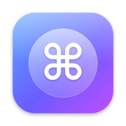
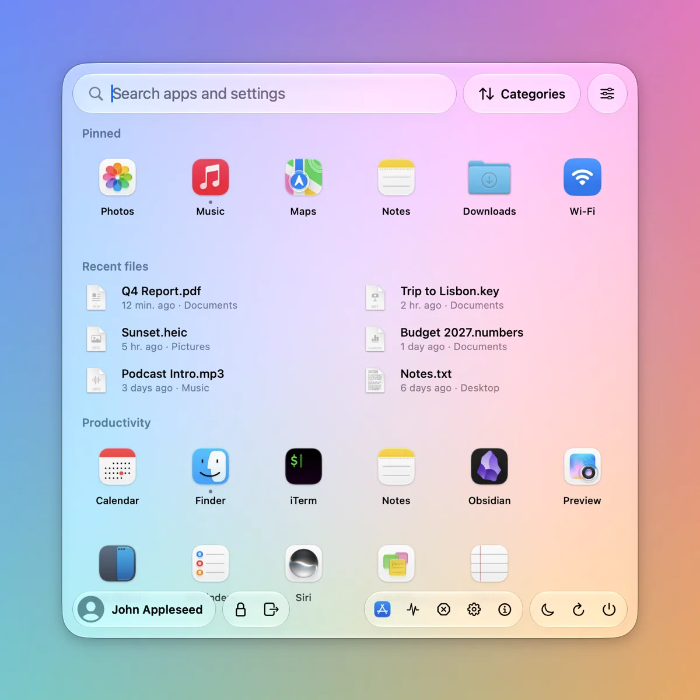
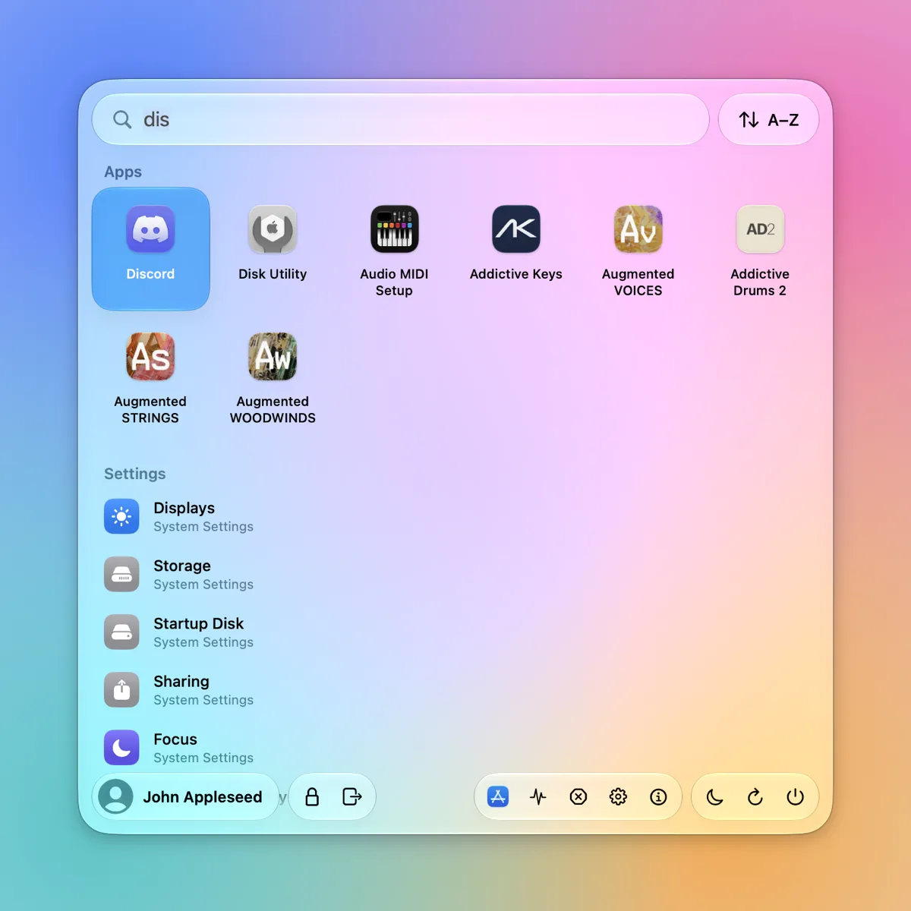

<p align="center"></p>

<h1 align="center">macOS Start Menu</h1>

<p align="center"><b><a href="https://corentingautier.dev/macos-start-menu/">Website</a> · <a href="https://github.com/corentin-gautier/macos-start-menu/releases/latest/download/Start-Menu.zip">Download</a></b></p>

<p align="center">
  
  
</p>

A Windows-style start menu for macOS. Tap **⌘ Command** on its own (press and
release, no other key) and a panel opens right below the Apple menu with:

- **All your apps** in a grid, alphabetically — read straight from the app
  folders, so no documents, archives or other Spotlight noise ever shows up.
- A **search field, already focused**: typing filters and ranks the apps and
  also suggests the matching **System Settings** panes (English and French
  keywords: "wifi", "dark mode", "mode sombre", "luminosité"…) and your
  **folders** (Home, Desktop, Documents, Downloads, Pictures, Movies, Music,
  iCloud Drive, Trash… — "images", "vidéos", "téléchargements" work too).
- A **grid or list** view (list rows show the app's category), picked in the
  sort menu.
- Two **styles**, picked in the sort menu: **Liquid Glass** (glass capsules,
  grouped buttons, glass highlights, the default) or **Classic** (flat fills).
- A **sort button** next to the search field: A–Z, Recent (grouped by Today,
  This week…), Most used, or Categories (Productivity, Music, Games…).
- **Your account** with its avatar (opens Users & Groups), followed by the
  session buttons: Lock and Log Out.
- **Icon buttons**: App Store, Activity Monitor, Force Quit, System Settings,
  About This Mac, then the power buttons: Sleep, Restart, Shut Down.

| Key | Action |
| --- | --- |
| ⌘ alone | Open / close the menu |
| Type | Search apps and settings |
| ← → ↑ ↓ | Move through the results |
| Return | Open the selected result |
| Escape, or click outside | Close |
| ⌘Q (menu open) | Quit Start Menu |

"Hide the Dock" in the sort menu hides the macOS Dock for good (auto-hide
with a very long reveal delay); turning it off restores your previous Dock
setting.

Right-click an app or a setting to **pin** it: pinned items stay at the top
of the menu, above the apps, in every sort.

Right-click an app to **hide** it (system apps can't be deleted: they live on
macOS's sealed, read-only system volume). Hidden apps leave the list and the
search; the sort menu's "Show Hidden Apps" lists them dimmed so they can be
unhidden. Right-click also offers to show an app in the Finder or to
**uninstall** it: after a
confirmation listing what will be removed, the app is quit if running, then the
app and the files it left in `~/Library` (preferences, caches, Application
Support, containers, saved state, logs, launch agents…) go to the Trash, so
everything can still be put back. System apps can't be uninstalled; files in
the system-wide `/Library` are left alone.

**Languages:** the app and the website are available in English, 简体中文,
हिन्दी, Español, العربية, Français, বাংলা, Português, Русский and 日本語. The app
follows the Mac's language; System Settings pane names are read from macOS
itself so they match what System Settings shows.

## Install

### Download

1. Download [Start-Menu.zip](https://github.com/corentin-gautier/macos-start-menu/releases/latest/download/Start-Menu.zip),
   unzip it and move `Start Menu.app` to Applications.
2. Open it. The app isn't notarized: when macOS blocks it, go to System
   Settings › Privacy & Security and click **Open Anyway**.
3. On first launch, Start Menu asks for the Accessibility permission (it opens
   Privacy & Security › Accessibility: turn *Start Menu* on) and adds itself to
   the Login Items. "Open at Login" in the sort menu turns that off.

### Homebrew

```sh
brew tap corentin-gautier/tap
brew trust --cask corentin-gautier/tap/macos-start-menu
brew install --cask corentin-gautier/tap/macos-start-menu
```

The cask lives in [corentin-gautier/homebrew-tap](https://github.com/corentin-gautier/homebrew-tap).

### Build from source

Requirements: macOS 26 or later, Xcode or the Command Line Tools (Swift 5.10+).

```sh
scripts/setup-signing.sh   # once: creates a local code signing certificate
scripts/install.sh         # builds, installs and launches (the app adds itself to Login Items)
```

On first launch macOS asks for the **Accessibility** permission
(System Settings › Privacy & Security › Accessibility › enable *Start Menu*).
It is needed to notice the Command key presses anywhere and to trigger
Force Quit (⌥⌘⎋). The menu works as soon as the switch is on, no restart
needed.

Restart and Shut Down open the usual macOS confirmation dialog. The first time,
macOS may ask to let Start Menu control "loginwindow": accept.

Uninstall: `scripts/uninstall.sh`.

## How it works

- **Command tap**: a listen-only `CGEventTap` watches modifier changes. A
  Command press counts as a tap only if it is released within 0.45 s with no
  key, click or other modifier in between, so shortcuts like ⌘C are never
  affected.
- **Panel**: a borderless, non-activating `NSPanel` (glass background on
  macOS 26+) hosting a SwiftUI view. It takes the keyboard without making the
  frontmost app lose focus, and hides as soon as it loses focus.
- **Apps**: `/Applications`, `/System/Applications` and `~/Applications`,
  scanned two levels deep (Utilities and vendor folders included), rescanned
  every time the menu opens.
- **Sorting**: Start Menu records every app that comes to the front (stored
  in its user defaults) for Recent and Most used; Spotlight's usage data is only
  a fallback since it is often missing. Categories come from the bundle ID
  rules in `AppCategory.swift`, then the app's declared
  `LSApplicationCategoryType`, then its install folder.
- **Settings**: a curated list of System Settings panes, opened through
  `x-apple.systempreferences:<extension bundle id>`.
- **Signing**: builds are signed with a self-signed certificate so the
  Accessibility permission survives rebuilds (an ad-hoc signature changes with
  every build and macOS would ask again).

## Project layout

```
Package.swift                 SwiftPM executable target
Resources/Info.plist          bundle info (agent app: no Dock icon, no menu bar)
Sources/StartMenu/
  main.swift, AppDelegate.swift
  CommandKeyMonitor.swift     lone ⌘ tap detection
  StartPanelController.swift  panel window, position, keyboard
  StartMenuModel.swift        search state, ranking, navigation, actions
  StartMenuView.swift         SwiftUI interface
  AppCatalog.swift            app discovery and icon cache
  AppCategory.swift           groups for the Categories sort
  UsageStore.swift            recent / most used tracking
  AppUninstaller.swift        uninstall and leftover files detection
  SettingsCatalog.swift       System Settings panes and keywords
  FolderCatalog.swift         user folders offered in search
  Search.swift                matching and scoring
  SystemActions.swift         power, lock, force quit, avatar
Resources/AppIcon.svg         app icon source (scripts/make-icon.sh → AppIcon.icns, site icons)
scripts/                      setup-signing, build, install, uninstall, package, make-icon
```

## Release

`scripts/release.sh <version> "<notes>"` builds and zips the app
(`scripts/package.sh`), publishes the GitHub release the website's Download
button points to, and bumps the Homebrew cask (version and sha256) in
`corentin-gautier/homebrew-tap`.

## Screenshots

`docs/img` screenshots are taken in demo mode (`STARTMENU_DEMO=1` shows a
generic account, `STARTMENU_DEMO_QUERY` pre-fills the search,
`STARTMENU_DEMO_BACKDROP=<image>` centers the panel over that image so the
glass has colors to refract), capturing the panel and its backdrop with
`screencapture -R`.

## License

All rights reserved.
